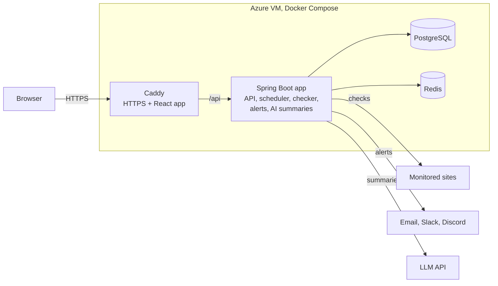

# Pulse

Uptime monitoring with incident detection, one alert per incident, LLM-written incident summaries
and public status pages.

**Live:** https://pulse.koreacentral.cloudapp.azure.com

## Features

- HTTP(S) checks every 30 s to 5 min, with SSRF protection (private and reserved addresses are refused)
- An incident opens after 3 failed checks in a row and closes after 2 successful ones
- One DOWN and one RECOVERED alert per incident and channel: email, Slack or Discord, retried with backoff
- A short AI-written summary of each incident (any OpenAI-compatible API; optional)
- Uptime and latency (p50 / p95) over 24 h, 7 days and 30 days
- Public status pages
- Safe to run as several instances: PostgreSQL row locks give each check to exactly one instance

Design and reasons: [docs/DESIGN.md](docs/DESIGN.md). Load test: [BENCHMARK.md](BENCHMARK.md).

## Architecture



## Run it locally

Requirements: Docker; Java 21 and Node 22.22+ for development and tests.

```bash
docker compose up --build              # app :8080, PostgreSQL :5433, Redis :6380, Mailpit :8025
cd frontend && npm ci && npm run dev   # http://localhost:5173, forwards /api to :8080
```

Emails (alerts, password reset) land in Mailpit: http://localhost:8025. API docs: http://localhost:8080/swagger-ui.
For AI summaries, put `AI_API_KEY=...` in a `.env` file next to `docker-compose.yml`.

Tests (Docker must be running; Testcontainers starts PostgreSQL and Redis):

```bash
cd backend && ./mvnw verify                                  # tests + coverage gate
cd frontend && npm run lint && npm test && npm run build
```

## Production

One Azure VM with Docker Compose: Caddy (HTTPS) in front of the app, PostgreSQL and Redis. GitHub Actions builds the
images after CI passes on `main`; `deploy/deploy.sh` rolls them out. Details: [deploy/README.md](deploy/README.md).

## Tech stack

Java 21 · Spring Boot 4 · PostgreSQL 17 · Flyway · Redis 7 · React 19 · TypeScript · Vite · Tailwind · Recharts ·
Testcontainers · Vitest · JaCoCo · Docker · GitHub Actions · Caddy · Azure
