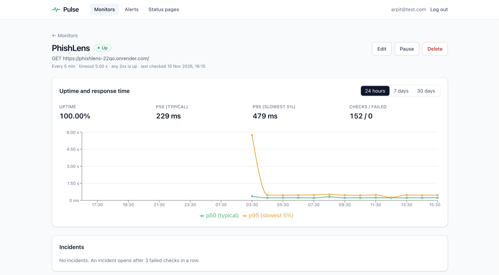
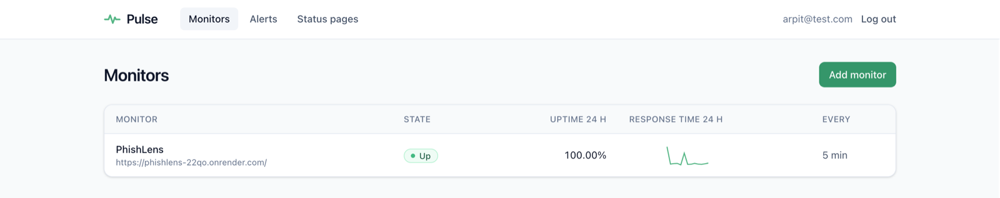
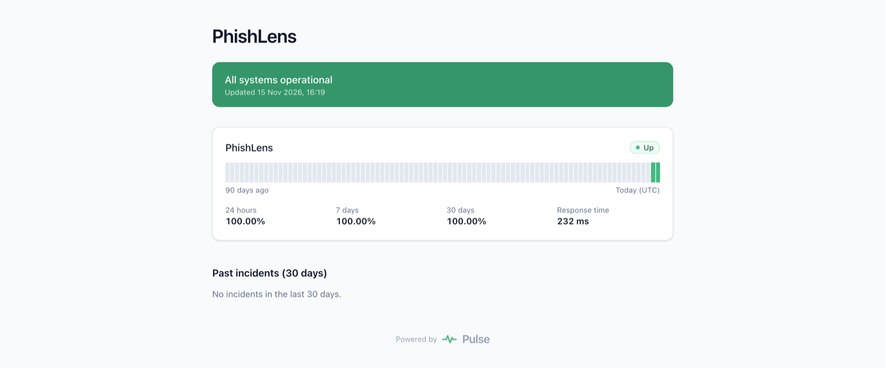
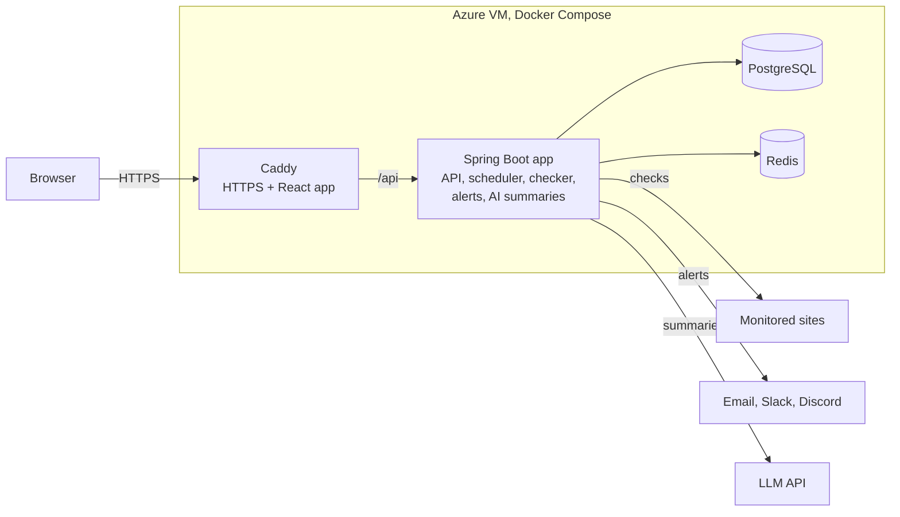

# Pulse

[](https://github.com/arpitmanitripathi/pulse/actions/workflows/ci.yml)

Uptime monitoring with incident detection, one alert per incident, LLM-written incident summaries
and public status pages.

**Live:** https://pulse.koreacentral.cloudapp.azure.com ·
**Public status page:** https://pulse.koreacentral.cloudapp.azure.com/s/phishlens



## What it does

- Checks HTTP(S) endpoints every 30 s to 5 min and tracks uptime and response time (p50 / p95) over 24 h, 7 and 30 days
- Opens an incident after 3 failed checks in a row and closes it after 2 successful ones
- Sends one DOWN and one RECOVERED alert per incident to email, Slack or Discord
- Adds a short AI-written summary to each incident (any OpenAI-compatible API; optional)
- Publishes public status pages

| Monitors | Public status page |
|---|---|
|  |  |

## Engineering highlights

- **Java 21 virtual threads:** every check, alert and AI call is plain blocking code on its own virtual thread;
  a semaphore caps checks in flight.
- **Several instances, no message broker:** due monitors are claimed with PostgreSQL `FOR UPDATE SKIP LOCKED`, so
  each check runs on exactly one instance (tested with two schedulers on one database).
- **Transactional outbox for alerts:** alerts are written in the same transaction as the incident, then sent with
  retries and backoff; a crash can't lose one, and RECOVERED never arrives before DOWN.
- **SSRF protection:** private and reserved addresses are refused, and the checker connects only to the addresses
  the guard approved, including after redirects.
- **AI never blocks alerting:** summaries run separately, and Pulse works fully without an API key.
- **Tested against real dependencies:** Testcontainers (PostgreSQL, Redis), WireMock, 80 % line coverage enforced in CI.

Design and reasons: [docs/DESIGN.md](docs/DESIGN.md). Load test (laptop): [BENCHMARK.md](BENCHMARK.md).

## Architecture



## Run it locally

Requirements: Docker; Java 21 and Node 22.22+ for development and tests.

```bash
docker compose up --build              # app :8080, PostgreSQL :5433, Redis :6380, Mailpit :8025
cd frontend && npm ci && npm run dev   # http://localhost:5173, forwards /api to :8080
```

Emails (alerts, password reset) land in Mailpit: http://localhost:8025. API docs: http://localhost:8080/swagger-ui.
For AI summaries, put `AI_API_KEY=...` in a `.env` file next to `docker-compose.yml`.

Tests (Docker must be running; Testcontainers starts PostgreSQL and Redis):

```bash
cd backend && ./mvnw verify                                  # tests + coverage gate
cd frontend && npm run lint && npm test && npm run build
```

## Production

One Azure VM with Docker Compose: Caddy (HTTPS) in front of the app, PostgreSQL and Redis. GitHub Actions builds the
images after CI passes on `main`; `deploy/deploy.sh` rolls them out. Details: [deploy/README.md](deploy/README.md).

## Tech stack

Java 21 · Spring Boot 4 · PostgreSQL 17 · Flyway · Redis 7 · React 19 · TypeScript · Vite · Tailwind · Recharts ·
Testcontainers · Vitest · JaCoCo · Docker · GitHub Actions · Caddy · Azure

## License

[MIT](LICENSE)
